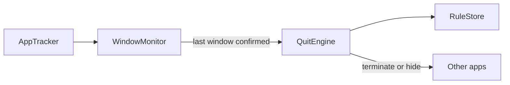
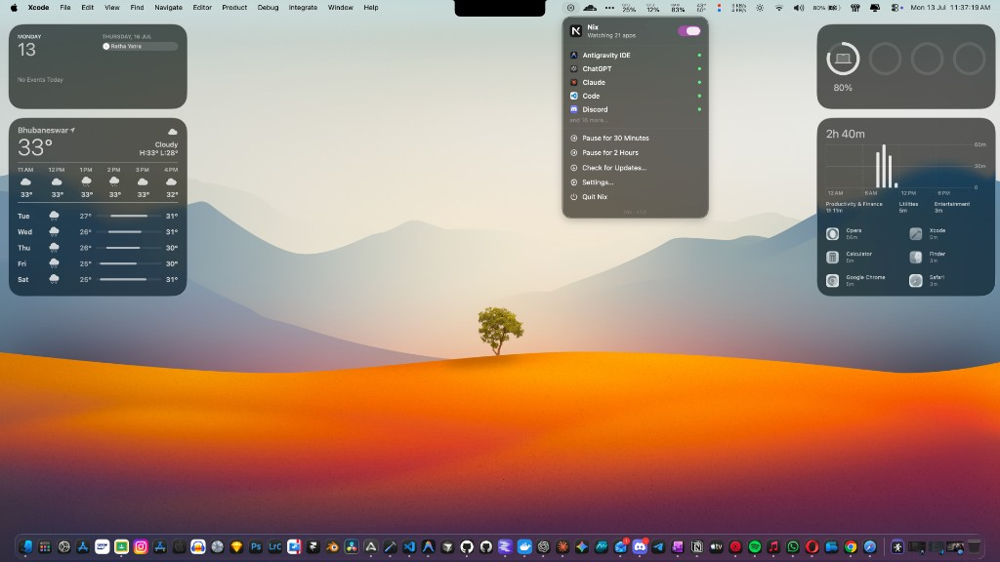
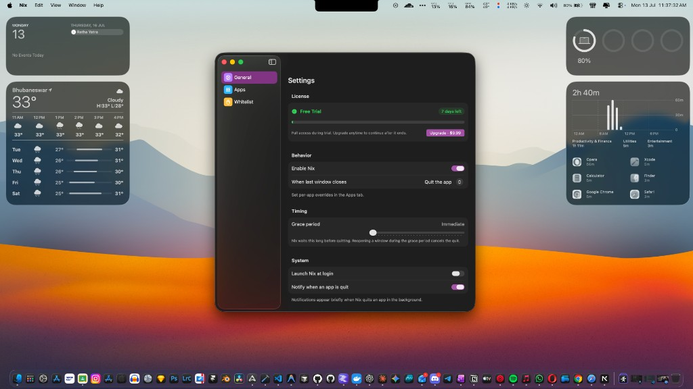
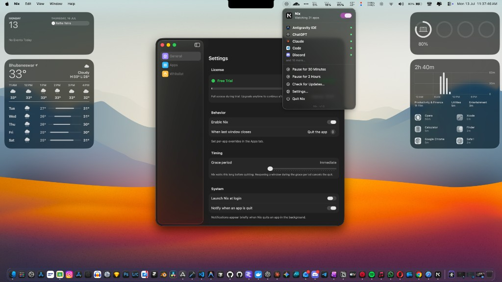

  

<h1 align="center">Nix</h1>

<strong>Close the window. Quit the app.</strong>

  
  
  
  

Nix is a menu bar utility for macOS. When you close the last window of an application, Nix quits that application the way Command-Q would. Apps you want to keep — Music, Messages, anything you mark — stay running.

This repository is a public engineering portfolio for the commercial product. It is not the Nix source tree, and it is not an open-source license. The application itself remains proprietary.

Product site: [nix-mu.vercel.app](https://nix-mu.vercel.app)

## The problem

On macOS, the close button closes a window. The process keeps running. That is a deliberate Apple design: apps stay warm so the next open is immediate. It is the right behavior for some apps and a quiet leak for the rest. People coming from Windows read the close button as "I am done." People who already understand the Mac still end up quitting apps by hand.

Nix is that preference, per application. It does not force-kill anything. The target app runs its own termination, including unsaved-changes dialogs. If the app refuses, Nix leaves it alone.

## Features

- Quit, hide, ignore, or ask when the last window closes.
- A global grace period from 0 to 30 seconds, with a live countdown in the menu bar. Reopening a window, activating the app, or unhiding it cancels the quit.
- Per-app overrides, plus a user whitelist. Finder, the Dock, SystemUIServer, and Notification Center are never touched.
- Hidden apps stay running. A minimized window is not treated as closed.
- Space switches and fullscreen closes do not quit an app that still has a window open.
- Menu bar status, pause for 30 minutes or 2 hours, optional notifications, and launch at login.
- First-launch onboarding, including the Accessibility permission Nix needs.
- Seven-day trial, then a one-time $9.99 license. No subscription and no account.
- Automatic updates through Sparkle.

The full surface, including the limitations, is in [docs/FEATURES.md](docs/FEATURES.md). The product narrative is in [docs/PRODUCT_OVERVIEW.md](docs/PRODUCT_OVERVIEW.md).

## Technology

Verified against the shipping project. Nix has one third-party dependency.

| Technology | Role |
|---|---|
| Swift 5 | Application code. Default actor isolation is the main actor. |
| SwiftUI | Menu bar popover, settings, onboarding, and paywall content. |
| AppKit | Process policy, `NSWindow`, `NSWorkspace`, `NSRunningApplication`. |
| Accessibility (`ApplicationServices`) | `AXObserver` and `AXUIElement` for window lifecycle in other apps. |
| Core Graphics | Window-list confirmation. Nix does not capture pixels. |
| ServiceManagement | `SMAppService` launch at login. No helper app. |
| UserNotifications | Optional banner after a quit Nix started has actually finished. |
| Combine | Workspace publishers and `ObservableObject` forwarding. |
| UserDefaults | Rules and preferences. |
| Keychain | License and trial state. |
| Sparkle 2.9.3 | Signed automatic updates. |
| os.Logger | Subsystem logging. No telemetry SDK. |

Deployment target is macOS 14.6. The App Sandbox is off, because this use of the Accessibility API is not available to a sandboxed Mac App Store process. Hardened runtime is on. Distribution is a notarized Developer ID disk image.

## Architecture

SwiftUI presents the interface. AppKit owns the process. `AppEnvironment` creates the services and is what the views observe.

`AppTracker` follows launch, quit, hide, and activation through `NSWorkspace`. `WindowMonitor` holds one accessibility observer per tracked app and is the only component allowed to decide that the last window is gone. `QuitEngine` applies the user's rule and the grace period, then calls `terminate()`, `hide()`, or an alert. `RuleStore` resolves permanent exclusions, the whitelist, and per-app behavior.

The path is event-driven. Nix does not poll other applications' windows to decide whether to quit. The permission flag is polled, because macOS does not tell the process when Accessibility is granted.

A fuller map, the startup sequence, and the concurrency model are in [docs/ARCHITECTURE.md](docs/ARCHITECTURE.md).

## Engineering

The hard part is not issuing Command-Q. It is knowing that the last real window is gone.

An accessibility window count of zero is often wrong. Switching Spaces hides windows from that query. Closing a fullscreen window must not quit an app that still has a window on another Space. Several apps hide when their close button is clicked. Some leave window records behind after the window is gone. Nix is biased toward missing a quit rather than taking an app the user is still using. It never escalates from `terminate()` to a forced kill.

Those problems, and the shape of the solutions, are written up in [docs/ENGINEERING_CHALLENGES.md](docs/ENGINEERING_CHALLENGES.md). The choices around actors, persistence, login items, and distribution are in [docs/TECHNICAL_DECISIONS.md](docs/TECHNICAL_DECISIONS.md).

The confirmation policy itself is commercial implementation and is not in this repository. The files under [examples/](examples/) are short illustrations of the surrounding platform code: menu bar lifecycle, Accessibility permission, launch at login, and the quit behaviors.

## Screenshots and demo

The logo above is the shipping Nix icon, also used in the popover and in onboarding. The menu bar status item itself is an SF Symbol, not this mark.

Menu bar popover. Nix lists the apps it is watching, and can pause, check for updates, or open Settings.

Settings, General. Trial status, the default quit behavior, the grace period, launch at login, and quit notifications.

The same Settings window with the menu bar popover open.

Product demo, 12 seconds.

https://github.com/user-attachments/assets/31ef4137-7e8f-4fad-801a-c1fd90a20ec7

Onboarding, 46 seconds, including the Accessibility permission.

https://github.com/user-attachments/assets/35a12bbc-1fb3-4d3b-8500-3ef03f3c3cc2

## Installation and compatibility

- macOS 14.6 Sonoma or later.
- Install from the notarized disk image on [nix-mu.vercel.app](https://nix-mu.vercel.app). This repository does not build Nix.
- On first launch, grant Accessibility access under System Settings → Privacy & Security → Accessibility. Nix cannot see window close events without it.
- Not distributed on the Mac App Store.

## Status

Version 1.0.4 is the shipping release. Monitoring, per-app rules, onboarding, launch at login, pause, Sparkle updates, and the trial and license gate are in that release.

Settings does not yet offer a per-app grace period. The stored rule can represent one. That control is not a feature of 1.0.4.

## Author

Sahan Maiti.

## License

Nix is proprietary software. Copyright (c) 2026 Sahan Maiti. All rights reserved.

You may read this repository. You may not use, copy, modify, distribute, sublicense, or sell the materials here without written permission. The full notice is [LICENSE](LICENSE).
