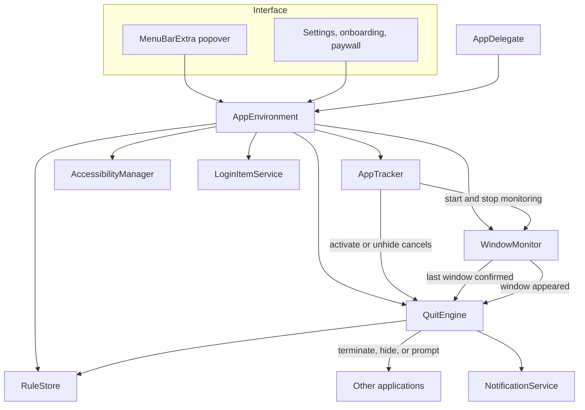

# Architecture

Nix is a single macOS process. SwiftUI draws the menu bar and the window contents. AppKit owns the process lifecycle, the windows, and the running applications. One object, `AppEnvironment`, creates the services and is the object SwiftUI observes.

The detection path is event-driven. There is no timer walking the window list to decide whether something should quit. Timers exist only for the Accessibility permission bit, for debounce and confirmation inside the monitor, and for a grace period that has already been decided.

## Components

| Piece | Role |
|---|---|
| `NixApp` | `@main`. Installs `AppDelegate` and a `MenuBarExtra` in window style. The status symbol is derived from enabled and paused. |
| `AppDelegate` | Sets the accessory activation policy, presents onboarding, settings, and the paywall as `NSWindow`s hosting SwiftUI, starts Sparkle in release builds, and accepts the activation URL. |
| `AppEnvironment` | Owns the services. Forwards their `objectWillChange` so a view that holds the environment redraws when a child changes. Applies the pause timer and the license gate. |
| `AppTracker` | Subscribes to `NSWorkspace` launch, terminate, hide, unhide, activate, and deactivate. Keeps the list of tracked apps. |
| `AccessibilityManager` | Reads `AXIsProcessTrusted()`. Polls, because the system has no grant notification. When permission appears, monitoring is retried for apps already being tracked. |
| `WindowMonitor` | One `AXObserver` per tracked process. Decides whether that process has actually lost its last window, then calls back into the engine. |
| `QuitEngine` | Looks up the behavior, applies the grace period, publishes the deadlines the popover counts down, and performs quit, hide, ignore, or prompt. |
| `RuleStore` | In-memory rules, encoded as JSON in `UserDefaults`. Resolves permanent exclusions, the user whitelist, then the per-app behavior. |
| `GlobalSettings` | `@AppStorage` preferences: enabled, default behavior, grace period, launch at login, notifications. |
| `LoginItemService` | `SMAppService.mainApp` register and unregister, plus a startup sync against the system status. |
| `NotificationService` | Local notifications through `UNUserNotificationCenter`. |
| License and trial services | Gate monitoring in release builds. Their storage and network details are not part of this repository. |

UI files are views over that environment: the popover, the three settings pages, onboarding, the paywall, and a small `NSVisualEffectView` bridge used to get a native material behind onboarding.

## Startup

1. `AppEnvironment` builds the services in dependency order: accessibility, rules, the decision engine, the window monitor, then the tracker. The tracker immediately enumerates running apps.
2. The monitor's "no windows left" callback is wired to `QuitEngine.evaluate`. "A window appeared" and activation or unhide are wired to cancel a pending quit. Termination clears grace state and, if Nix initiated that quit, posts the notification.
3. Launch-at-login is reconciled with `SMAppService` before the user can look at the toggle.
4. `AppDelegate` forces the accessory policy, asks for notification authorization, and either shows onboarding or the paywall gate.
5. Release builds start Sparkle and revalidate a stored license. Debug builds skip Sparkle and run an internal verification suite shortly after launch.

## How a quit happens

1. The user closes a window in another app.
2. macOS delivers an accessibility notification to the `AXObserver` Nix registered for that process. The callback is a C function. It hops to the main queue and then into the main actor before any state changes.
3. The monitor debounces and confirms. An accessibility count of zero is not sufficient. A window that still exists on another Space must keep the app alive. A Space switch, which only deactivates the app, must not quit it. Apps that hide instead of closing must not be treated as windowless.
4. Only after that confirmation does `onZeroWindows` run.
5. The engine stops if Nix is disabled, paused, or the target is already hidden or terminated. Otherwise it resolves behavior: permanent exclusion, then user whitelist, then a per-app rule, then the global default.
6. Quit either calls `terminate()` now or schedules it and publishes a deadline. Hide, ignore, and prompt do what their names say. Prompt is an `NSAlert`.
7. If `terminate()` returns false, nothing further happens. Nix does not call `forceTerminate()`.
8. `NSWorkspace` later reports that the process ended. The tracker drops it and removes the observer. If this termination is one Nix asked for, and notifications are enabled, a banner is posted.

## Process boundaries Nix does not cross

- No helper tool and no XPC service of Nix's own. Sparkle brings its own update helpers inside its framework.
- No sandbox. Hardened runtime is enabled.
- No screen capture.
- Preferences are local. There is no sync service in the shipping app.
- The third-party dependency set is Sparkle 2.9.3, resolved through Swift Package Manager. UI, lifecycle, accessibility, rules, and notifications are system frameworks.

## Concurrency

The project sets Swift's default actor isolation to the main actor. The services that own published state are main-actor types. Workspace publishers are received on the main queue. The accessibility callback is the one place that is explicitly nonisolated, because the function-pointer signature cannot be an actor method. Work it hands off uses `MainActor.assumeIsolated` only after it is already on the main queue.

That choice fits the product. Window events, menu bar state, and AppKit calls all belong on the main thread. There is no background pipeline that would justify a custom actor graph.

## What is deliberately absent here

`WindowMonitor` is the part that makes the product correct, and it is the part this repository does not publish. The confirmation rules, the private window-server lookup used to discard leftover window records, and the handling of specific applications are commercial implementation. [`ENGINEERING_CHALLENGES.md`](ENGINEERING_CHALLENGES.md) explains the problems those rules exist to solve. [`examples/`](../examples/) shows the surrounding platform patterns without that policy.
